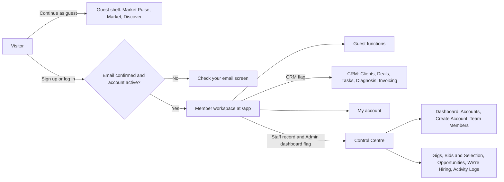
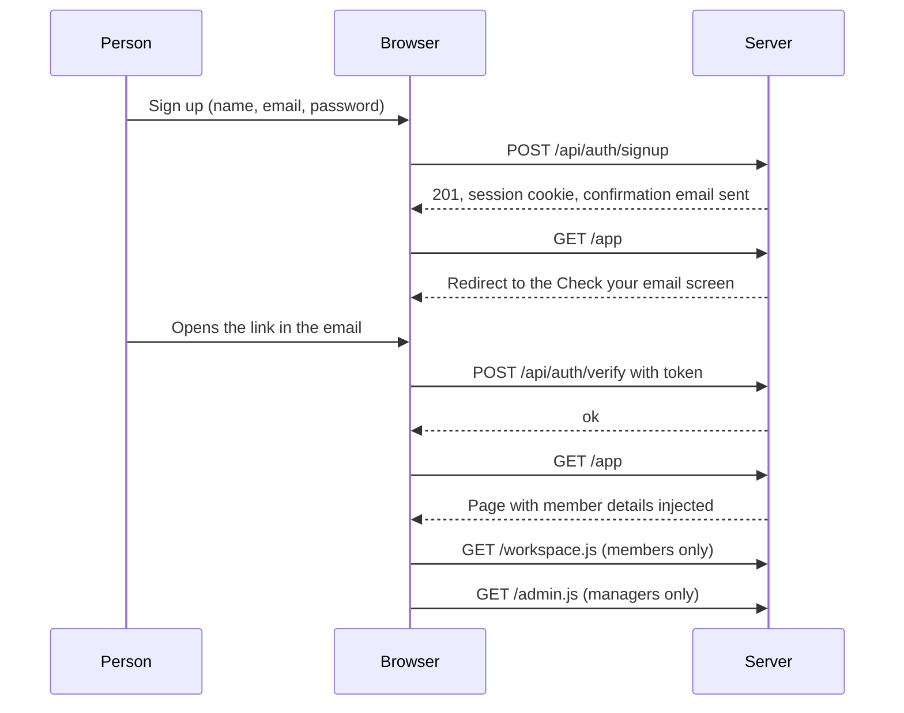
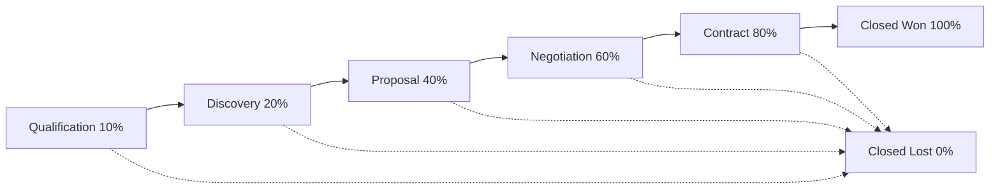
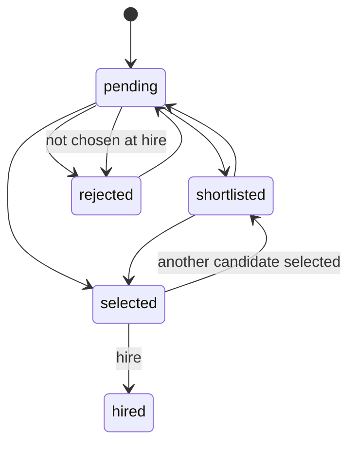
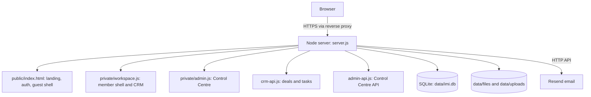
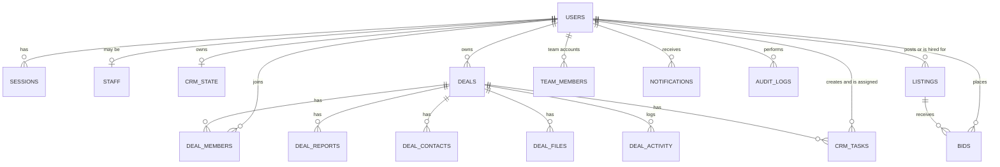

# IMI Platform: Product Requirements Document

| | |
|---|---|
| **Product** | IMI Platform (market intelligence, CRM and business management) |
| **Document version** | 1.1, describing platform release **3.5.0** |
| **Last updated** | 2026-10-11 |
| **Status** | Living document. Requirement statuses reflect what is built and verified today. |
| **Product owner** | _to be filled in_ |
| **Audience** | Product, engineering, design, QA, and anyone who needs to extend or operate the platform |

> **How to read this document.** Every requirement has an ID (for example `DEAL-12`), a priority (MoSCoW) and a status. Statuses describe the *current build*: ✅ shipped and verified, ⚠️ partly built or with a known limitation, 🔲 planned, not built. Section 12 lists every known gap in one place. Where the document says "the server enforces", it was checked against the code.

---

## Table of contents

1. [Overview](#1-overview)
2. [Users, roles and permissions](#2-users-roles-and-permissions)
3. [Product map](#3-product-map)
4. [Functional requirements](#4-functional-requirements)
   - [4.1 Accounts and access](#41-accounts-and-access)
   - [4.2 My account](#42-my-account)
   - [4.3 Workspace shell](#43-workspace-shell)
   - [4.4 Guest functions](#44-guest-functions)
   - [4.5 CRM: Clients](#45-crm-clients)
   - [4.6 CRM: Diagnosis](#46-crm-diagnosis)
   - [4.7 CRM: Invoicing](#47-crm-invoicing)
   - [4.8 CRM: Deals](#48-crm-deals)
   - [4.9 CRM: Tasks](#49-crm-tasks)
   - [4.10 Notifications](#410-notifications)
   - [4.11 Control Centre](#411-control-centre)
5. [Non-functional requirements](#5-non-functional-requirements)
6. [Architecture](#6-architecture)
7. [Data model](#7-data-model)
8. [API reference](#8-api-reference)
9. [Business rules and limits](#9-business-rules-and-limits)
10. [Configuration and operations](#10-configuration-and-operations)
11. [Quality and testing](#11-quality-and-testing)
12. [Known gaps and risks](#12-known-gaps-and-risks)
13. [Roadmap](#13-roadmap)
14. [Open questions](#14-open-questions)
15. [Appendix](#15-appendix)

---

## 1. Overview

### 1.1 Purpose

IMI Platform gives small teams one place to follow the market, manage their client relationships and deals, diagnose the health of a client's business, invoice for the work, and run the platform itself (accounts, managers, gigs, hiring and bids).

### 1.2 Problems it solves

| Problem | How the platform addresses it |
|---|---|
| Market and opportunity information is scattered. | A guest area with market news, a market table and an opportunities page (**Discover**). |
| Client work lives in spreadsheets and chat. | A CRM with clients, deals, tasks, a business-health **Diagnosis** and **Invoicing**. |
| Several people work one deal but progress is invisible. | **Shared deals** with a team, one **daily progress report per member per day**, tasks, files and a timeline. |
| Platform operators need control without developer help. | A **Control Centre** for accounts, managers, gigs/opportunities/hiring posts, bids and an activity log. |

### 1.3 Goals

| # | Goal | Measure (target) |
|---|---|---|
| G1 | A new team can install and reach a working admin account in minutes, without commands. | Browser setup on first run (verified). |
| G2 | Everyone on a deal can see and record progress daily. | Share of deal members with a report each day (to be tracked). |
| G3 | Operators can manage people and listings safely. | Every change is permission-checked and recorded in the activity log (verified). |
| G4 | Private CRM data stays private; shared data is shared only with people the owner chose. | Strangers receive "not found" for deals and files (verified by tests). |
| G5 | The platform runs with no third-party packages and one data folder. | Zero npm dependencies; one SQLite file plus two folders (verified). |

### 1.4 Non-goals (current release)

- Real-time market data feeds or trading.
- Payments, payment status or accounting integration for invoices.
- Calendar, email or phone integrations (Calls and emails are task *types* only).
- Multi-tenant organisations with separate workspaces.
- Horizontal scaling or high availability.
- Native mobile apps (the web app is responsive).

### 1.5 Success metrics (proposed)

| Metric | Definition |
|---|---|
| Activation | New confirmed accounts that create a client or deal within 7 days. |
| Collaboration | Deals with 2+ members that receive 2+ daily reports in a week. |
| Task hygiene | Share of assigned tasks completed on or before the due date. |
| Operator efficiency | Median time from account request to account created in the Control Centre. |
| Reliability | Uptime of `/healthz`; count of server errors per week. |

### 1.6 Glossary

| Term | Meaning |
|---|---|
| **Member** | A signed-in person with a confirmed email. |
| **Guest** | Someone who browses without an account. |
| **Manager** | A member with a staff record and the *Admin dashboard* access flag. Uses the Control Centre. |
| **Super admin** | The highest manager role. Can create other super admins. |
| **Access flags** | Per-account switches: Main platform, CRM, Admin dashboard, API. |
| **Deal owner** | The member who created the deal. Controls its stage, team and deletion. |
| **Daily report** | A member's progress entry for one day on one deal. |
| **Section** | A gig's category: **Bounty** or **Marketing gig**. |
| **We're Hiring** | The Jobs listing type (hiring posts). |
| **Workspace** | The signed-in application shell at `/app`. |

---

## 2. Users, roles and permissions

### 2.1 Personas

| Persona | Needs | Main areas |
|---|---|---|
| **Visitor / guest** | See what the platform offers before signing up. | Landing page, guest shell. |
| **Member (CRM user)** | Track clients and deals, log daily progress, manage tasks, invoice. | Workspace, CRM. |
| **Member (no CRM)** | Use the guest functions with an account. | Guest functions, My account. |
| **Deal owner** | Run a deal and its team. | Deals, Tasks. |
| **Deal member** | Contribute to someone else's deal. | The shared deal, assigned tasks. |
| **Manager** | Run the platform within the permissions they hold. | Control Centre. |
| **Super admin** | Set up the platform and its managers. | Everything. |

### 2.2 Account status and access flags

| Field | Values | Effect |
|---|---|---|
| Status | `active`, `pending`, `suspended` | `suspended` cannot sign in and loses live sessions at once. `pending` is an invited manager who has not set a password yet. |
| Deleted | soft delete (`deleted_at`) | Cannot sign in; hidden everywhere; the email stays reserved. |
| Email confirmed | `verified_at` set | Required to open the workspace (unless confirmation is switched off). |
| Flag `crm` | true/false | **Enforced.** Required for CRM data, Deals, Tasks and the CRM menu. |
| Flag `admin_dashboard` | true/false | **Enforced.** Together with an active staff record, opens the Control Centre. |
| Flag `main_platform` | true/false | Stored and editable; **not enforced** (see [12](#12-known-gaps-and-risks)). |
| Flag `api` | true/false | Stored and editable; **not enforced**. |
| Tier | `free`, `premium` | A label only; **no feature difference** today. |

Accounts created by members themselves get `crm = true`. Accounts created in the Control Centre get the flags chosen there (CRM off by default).

### 2.3 Manager roles and permission presets

Choosing a role pre-fills its permissions; a super admin or admin can adjust them (never beyond what they hold themselves).

| Role | Manage content | View reports | Manage users | Access CRM | Manage listings |
|---|:-:|:-:|:-:|:-:|:-:|
| `super_admin` | ✔ | ✔ | ✔ | ✔ | ✔ |
| `admin` | ✔ | ✔ | ✔ | ✔ | ✔ |
| `content_manager` | ✔ | ✔ |  |  | ✔ |
| `community_manager` | ✔ |  | ✔ |  |  |
| `marketing_lead` | ✔ | ✔ |  |  |  |
| `developer` |  | ✔ |  |  |  |
| `team_member` | ✔ | ✔ | ✔ |  |  |

> **Enforcement today.** The server checks only three permissions: `manage_users`, `manage_listings` and `view_reports`. `manage_content` and `access_crm` can be assigned and are shown in the interface, but no endpoint depends on them yet (see [12](#12-known-gaps-and-risks)).

### 2.4 What each permission unlocks

| Capability | Requirement |
|---|---|
| Control Centre dashboard, global search, own manager profile, image upload | Any active manager |
| Accounts list, create, edit, suspend, reactivate, reset password, delete, team members of a team account (**for ordinary accounts; a platform manager's own account can only be changed by a super admin**) | `manage_users` |
| Team Members (platform managers): list, invite, edit, revoke | Role `super_admin` or `admin` **and** `manage_users` |
| Gigs, Opportunities, We're Hiring (CRUD, status, bulk), Bids & Selection | `manage_listings` |
| Activity logs | `view_reports` |
| Grant the *Admin dashboard* flag to an account | `super_admin` only |
| Create, modify or revoke a `super_admin` | `super_admin` only |

### 2.5 Manager safeguards

- A manager cannot grant permissions they do not hold.
- A manager cannot change their own role or permissions, suspend themselves, or delete themselves.
- **A platform manager's account (email, status, access flags, password-reset link, deletion) can only be changed in Accounts by a super admin.** Otherwise a manager holding only *Manage users* could change a super admin's email, request a reset link and take the account over. Roles and permissions are handled in Team Members.
- The last active super admin cannot be revoked.
- Accounts that are managers cannot be deleted until their manager access is revoked.
- Access is re-checked in the database on **every** request, so suspending or revoking takes effect immediately.

### 2.6 Permission matrix by area

| Area | Guest | Member (no CRM) | Member (CRM) | Deal member | Deal owner | Manager (with permission) |
|---|:-:|:-:|:-:|:-:|:-:|:-:|
| Guest functions | ✔ | ✔ | ✔ | ✔ | ✔ | ✔ |
| My account |  | ✔ | ✔ | ✔ | ✔ | ✔ |
| Clients, Diagnosis, Invoicing (own, private) |  |  | ✔ | ✔ | ✔ | if CRM flag |
| Create a deal |  |  | ✔ | ✔ | ✔ | if CRM flag |
| View a deal, log reports, add tasks and files |  |  |  | ✔ | ✔ |  |
| Change stage, edit deal, manage team, delete deal |  |  |  |  | ✔ |  |
| Control Centre screens |  |  |  |  |  | per permission |

---

## 3. Product map

### 3.1 Screen inventory

| Area | Screens |
|---|---|
| Public | Landing and login card, sign up, forgot/reset password, check-your-email, first-run setup |
| Guest shell | Market Pulse (News), Market, Discover (Bounties, Marketing Gigs, We're Hiring), Watchlist and Help (placeholders) |
| Member workspace | My account |
| CRM | Clients, Deals (list, board, detail, preview), Tasks, Diagnosis, Invoicing |
| Control Centre | Dashboard, Accounts, Create Account, Team Members, Gigs, Bids & Selection, Opportunities, We're Hiring, Activity Logs |

---

## 4. Functional requirements

### 4.1 Accounts and access

**Summary.** Email-and-password accounts with confirmation by email, password reset, server-side sessions, and a browser-based first-run setup for the first administrator.

| ID | Requirement | Priority | Status |
|---|---|:-:|:-:|
| AUTH-01 | A visitor can use the guest functions without an account. | Must | ✅ |
| AUTH-02 | Sign up with a name (up to 80 characters), a valid email, and a password of 8–200 characters. The account is created active and unconfirmed, the person is signed in, and a confirmation email is sent. | Must | ✅ |
| AUTH-03 | The confirmation link is valid for 24 hours and works once. Until confirmed, the workspace redirects to a "Check your email" screen with a **Resend** button (3 per hour per account). | Must | ✅ |
| AUTH-04 | Log in with email and password. Errors never reveal whether the email exists. "Remember me" keeps the session for 30 days, otherwise 12 hours. | Must | ✅ |
| AUTH-05 | A suspended account is refused with a clear message after a correct password. A deleted account is treated as unknown. | Must | ✅ |
| AUTH-06 | Throttling: 5 failed logins per email per 15 minutes, and 20 authentication requests per minute per IP address. | Must | ✅ |
| AUTH-07 | "Forgot password" always answers the same way. The reset link lasts 1 hour, works once, and may be requested 3 times per hour per email. | Must | ✅ |
| AUTH-08 | A completed reset signs the person out everywhere, marks the email confirmed, and activates an invited (`pending`) account. | Must | ✅ |
| AUTH-09 | Sessions are server-side random tokens in an `HttpOnly`, `SameSite=Lax` cookie (`Secure` in production). Only a hash is stored. | Must | ✅ |
| AUTH-10 | Logout ends the session on the server. | Must | ✅ |
| AUTH-11 | **First-run setup.** While no super admin record exists (even a suspended one counts), the login card shows "Set up the admin account". It needs no code on the machine running the server. From anywhere else it needs `SETUP_CODE`: in production this must be set explicitly and be 12+ characters, and it is never written to the logs (in development a random code is printed). Password of at least 10 characters. It signs the new admin in and closes once an admin exists. | Must | ✅ |
| AUTH-12 | **Settings bootstrap.** `SUPER_ADMIN_EMAIL`, `SUPER_ADMIN_PASSWORD` (10+) and `SUPER_ADMIN_NAME` create the first super admin once, only while no super admin record exists, and never reset a password or re-create an admin on a later start. The server finishes this step before it accepts requests. | Should | ✅ |
| AUTH-13 | Command-line tools: `create-super-admin` (creates or upgrades an account) and `check-admin` (explains why an account cannot open the Control Centre). | Should | ✅ |
| AUTH-14 | Accounts created by a manager are treated as confirmed. Invited managers are `pending` until they set a password from their link (72 hours). | Must | ✅ |
| AUTH-15 | Email confirmation can be switched off with `REQUIRE_EMAIL_VERIFICATION=0` for private launches. | Could | ✅ |
| AUTH-16 | Confirmation, reset and invitation emails are sent through Resend. Without a key, links are printed to the server console **in development only**; in production nothing secret is logged and a warning says the email was not sent. | Must | ⚠️ needs provider setup before real users |
| AUTH-17 | Passwords use a self-describing scrypt hash. A hash made by an earlier release still works and is upgraded when its owner signs in. | Must | ✅ |

### 4.2 My account

**Summary.** Any member manages their own details, email and password. Managers also manage a photo and see their role.

| ID | Requirement | Priority | Status |
|---|---|:-:|:-:|
| ACC-01 | Edit full name (2–120), phone (international format, 7–15 digits), bio (up to 500). Managers can upload a photo (PNG or JPG). | Must | ✅ |
| ACC-02 | Change password: requires the current password; 8+ characters (managers 10+); must differ from the current one; signs out all other devices. | Must | ✅ |
| ACC-03 | Change email: requires the current password; the new email must be unique; takes effect immediately; signs out other devices; logged. | Must | ⚠️ no confirmation email to the new address |
| ACC-04 | Sensitive actions (password and email) are limited to 8 attempts per 15 minutes per account. | Must | ✅ |
| ACC-05 | Managers see their role and permissions, read-only. | Should | ✅ |
| ACC-06 | The sidebar **Settings** item and the user menu both open My account. | Should | ✅ |
| ACC-07 | Profile, password and email changes are written to the activity log without ever recording a password. | Should | ✅ |

### 4.3 Workspace shell

| ID | Requirement | Priority | Status |
|---|---|:-:|:-:|
| WS-01 | After login the member lands in one workspace. The sidebar shows the guest functions, the **CRM** group (CRM flag) and the **Control Centre** group (managers). Groups behave as an accordion: the group you are in stays open. | Must | ✅ |
| WS-02 | Member code is protected: `/workspace.js` needs a confirmed, active session; `/admin.js` needs an active manager. Guests and non-managers receive 401/403 and never download that code. | Must | ✅ |
| WS-03 | A member without CRM access and who is not a manager sees only the guest functions and My account. | Must | ✅ |
| WS-04 | Top bar: search (⌘K / Ctrl+K), notification bell, user menu (My account, Log out). Search filters Clients, Deals and Tasks on their screens, and runs a global search in the Control Centre. | Should | ✅ |
| WS-05 | The sidebar collapses to icons below 980 px; the deal list and detail become single-column below 1000 px; tables scroll horizontally. | Should | ✅ |
| WS-06 | A member who opens the home address is sent straight to `/app`. Links with a query (confirmation, reset) still reach the home page. | Should | ✅ |
| WS-07 | Dark theme only. | Could | ⚠️ no light theme |

### 4.4 Guest functions

| ID | Requirement | Priority | Status |
|---|---|:-:|:-:|
| GF-01 | **Market Pulse** (News): ticker cards, category filters, top stories, saved stories (bookmarks stored in the browser). | Should | ⚠️ built-in sample content |
| GF-02 | **Market**: a landing page with two entry cards, **Coins** and **NFTs**, leading to market views. | Should | ⚠️ built-in sample content |
| GF-03 | **Discover**: three entry cards: Bounties, Marketing Gigs and We're Hiring. | Should | ⚠️ sample content; not yet connected to listings |
| GF-04 | **Watchlist** and **Help** sidebar items. | Could | 🔲 placeholders without behaviour |
| GF-05 | "Continue as guest" shows the shell without any CRM or Control Centre. | Must | ✅ |

### 4.5 CRM: Clients

**Summary.** A private client list per account.

| ID | Requirement | Priority | Status |
|---|---|:-:|:-:|
| CLI-01 | Add a client: name (required), email (required, valid), company, status `Lead` / `Active` / `Past`. Inline validation. | Must | ✅ |
| CLI-02 | Table with search, status filter, row selection, last-contact date. | Must | ✅ |
| CLI-03 | Row actions: mark contacted today, open Diagnosis, create invoice, delete (also deletes that client's diagnoses, diagnosis project and invoices, after confirmation). | Must | ✅ |
| CLI-04 | Export to CSV (selected rows, otherwise all). | Should | ✅ |
| CLI-05 | Header statistics: total clients, active clients, pending follow-ups (clients with status Lead). | Should | ✅ |
| CLI-06 | Quick actions: add client, export, run diagnosis, create invoice. | Should | ✅ |
| CLI-07 | Data is private to the account and saved to the server automatically (debounced 400 ms; flushed on logout and page close). Browser data created before accounts existed is imported once. | Must | ✅ |

### 4.6 CRM: Diagnosis

**Summary.** A six-lens health check for a client's project, with scoring, charts, snapshots over time and a consulting-style report.

**Lenses and weights**

| Lens | Weight |
|---|:-:|
| Traffic | 15% |
| Conversion | 20% |
| Activation | 15% |
| Value Capture (Direct or Indirect path) | 15% |
| Retention | 15% |
| Ecosystem & Partnership | 20% |

| ID | Requirement | Priority | Status |
|---|---|:-:|:-:|
| DIA-01 | Each lens has five Yes/No questions. A lens score is Yes answers ÷ 5 × 100 (unanswered questions do not count as Yes). | Must | ✅ |
| DIA-02 | The overall score is the weighted sum of lens scores (0–100). | Must | ✅ |
| DIA-03 | Status bands: ≤20 Critical Condition, ≤40 Weak Foundation, ≤60 Developing Project, ≤80 Strong Growth Foundation, ≤100 High-Performance Project. | Must | ✅ |
| DIA-04 | Recommended package: **Growth Foundation** if two or more answered lenses score ≤20 or the overall score is below 40; **Growth Acceleration** below 75; otherwise **Ecosystem Expansion**. | Must | ✅ |
| DIA-05 | Priority order lists lenses by largest gap. Recommended services come from a fixed map for any answered lens below 60%; extra services can be added or removed by hand. Services: Project Planning, Design & Build, Community Management & Moderation, Research & Analytics, Marketing, Collaboration & Partnership Management, Social Media Management, Business Development. | Must | ✅ |
| DIA-06 | Business model classification from offering type and value-capture path, with an override field. | Should | ✅ |
| DIA-07 | Charts: health gauge, bar, radar, donut, sunburst and a trend line across snapshots. | Should | ✅ |
| DIA-08 | **Save Snapshot** records a dated result; the trend needs two or more snapshots. Per-snapshot reports can be reopened. | Must | ✅ |
| DIA-09 | Report preview: editable in the page, print to PDF, download HTML; Word export (`.doc`) with the charts embedded as images. | Must | ✅ |
| DIA-10 | Answers save to the account as the user works. "New assessment" clears answers and notes but keeps snapshots. Diagnoses saved by the first version are kept as snapshots. | Must | ✅ |

### 4.7 CRM: Invoicing

| ID | Requirement | Priority | Status |
|---|---|:-:|:-:|
| INV-01 | Build an invoice for a client from a catalogue of services, plus custom lines. Quantity and unit price are editable; lines can be removed. | Must | ✅ |
| INV-02 | Catalogue (Naira): Business Health Diagnostic ₦150,000; Strategic Planning Session ₦250,000; Market Research & Analysis ₦180,000; Process Optimization Consulting ₦220,000; Staff Training & Development ₦120,000; Follow-up Implementation Support ₦100,000. | Must | ✅ |
| INV-03 | Subtotal, tax (default 7.5%, editable) and total due. Notes field. | Must | ✅ |
| INV-04 | **Save invoice** and **Save & Print / PDF** (browser print with the application chrome hidden). Saved invoices are listed per client. | Must | ✅ |
| INV-05 | Header statistics: invoices, total billed, clients billed. | Should | ✅ |
| INV-06 | Invoice numbering, payment status, due dates, multiple currencies. | Should | 🔲 |

### 4.8 CRM: Deals

**Summary.** Deals are **shared**: the owner adds other members by email and everyone on the deal sees it in their own list. Members log one progress report per day, work tasks, share files and see a timeline.

The owner may set any stage at any time. A deal can also be **On Hold** (a flag, independent of stage).

| ID | Requirement | Priority | Status |
|---|---|:-:|:-:|
| DEAL-01 | Create a deal: company, deal name (required), value, currency (USD, NGN, EUR or GBP in the interface), stage, priority (low, medium, high), expected close date, source, tags (up to 10), description. The creator becomes the **owner** and first member. | Must | ✅ |
| DEAL-02 | **List view** (three columns on wide screens): deal list with tabs *All / Active / Closed / On Hold* and counts, search, stage filter and "My deals"; the selected deal with header, metrics, stage stepper and tabs; a right rail with team, progress and activity. | Must | ✅ |
| DEAL-03 | **Board view**: one column per stage with the deal count and **Total** and **Weighted** amounts (value × stage probability). Owners can drag a card to another column. | Must | ✅ |
| DEAL-04 | **Preview panel** (board): opens beside the board with owner, value, weighted value, expected close, team, progress, latest daily reports, open tasks and recent activity, plus **Open deal**. | Must | ✅ |
| DEAL-05 | Deal tabs: Overview, Tasks, Team, Files, Notes, Timeline. | Must | ✅ |
| DEAL-06 | **Owner-only**: edit fields, change stage (also by clicking the stepper), put on hold or resume, mark won or lost (with an optional reason), reopen, delete, add or remove members, edit a member's role label. Deletion hides the deal, its tasks, notes and files for everyone. | Must | ✅ |
| DEAL-07 | **Team**: the owner adds a member by email. The person must have a confirmed, active account **with CRM access**. Up to 25 members. Each member has a role label (for example "Marketing Lead"). | Must | ✅ |
| DEAL-08 | A member can leave a deal. The owner cannot be removed. When someone leaves or is removed, their open tasks return to the owner. | Must | ✅ |
| DEAL-09 | **Key contacts** (name, role, email, phone, tag such as Primary, Technical, Procurement). Any member can add, edit or delete. | Should | ✅ |
| DEAL-10 | **Daily reports**: each member records *what I did today*, a status (Completed, In progress, Blocked) and an optional next step. **One report per member per deal per day**: submitting again the same day updates it. | Must | ✅ |
| DEAL-11 | Report date rules: not more than one day ahead, not older than 7 days. Authors can edit their own daily report only on the day (today or yesterday's date); authors can edit their own general notes at any time. The author or the deal owner can delete an entry. | Must | ✅ |
| DEAL-12 | **Notes tab** shows entries grouped by day (Today, Yesterday, dates) and a banner naming who has **not yet reported today**, turning green when everyone has. | Must | ✅ |
| DEAL-13 | **General notes** (not limited to one per day) share the same feed. | Should | ✅ |
| DEAL-14 | **Files**: PDF, Word, Excel, PowerPoint, PNG, JPG, CSV or TXT up to 10 MB; up to 50 per deal; the real file type is checked from its bytes; downloads are attachments (never opened in the page). Uploader or owner can delete. | Must | ✅ |
| DEAL-15 | **Timeline** records who did what: deal created, stage and value changes, hold/resume, priority, members, contacts, tasks added or completed, reports and notes, files. | Must | ✅ |
| DEAL-16 | **Progress** is tasks completed ÷ total tasks on the deal, with a donut and counts (Completed, In progress, Blocked, Not started). | Should | ✅ |
| DEAL-17 | A stranger who guesses a deal or file address receives "not found"; nothing about it is revealed. | Must | ✅ |
| DEAL-18 | Link a deal to a client from **Clients** (today a deal holds a company name only). | Should | 🔲 |
| DEAL-19 | Multiple or custom pipelines; stage-change approvals. | Could | 🔲 |

### 4.9 CRM: Tasks

**Summary.** A task list that works on its own (personal tasks) or inside a deal (shared with its team).

| ID | Requirement | Priority | Status |
|---|---|:-:|:-:|
| TASK-01 | Create a task: title (required), type (To-do, Call, Email, Meeting, Follow-up), priority, due date, status (Not started, In progress, Blocked, Done), notes, optional deal, assignee. | Must | ✅ |
| TASK-02 | A task with no deal can only be assigned to yourself. A task on a deal can be assigned only to a member of that deal. | Must | ✅ |
| TASK-03 | **Visibility**: you see tasks you created, tasks assigned to you, and every task on any deal you belong to. Tasks of a deleted deal disappear. | Must | ✅ |
| TASK-04 | **Edit** by the creator, the assignee or the deal owner. **Delete** by the creator or the deal owner. Only the creator can move a task to another deal. | Must | ✅ |
| TASK-05 | Views with live counts: **All tasks**, **Due today**, **Overdue** (not done and due before today), **Upcoming** (not done and due after today). "Today" is the person's own calendar date. | Must | ✅ |
| TASK-06 | Filters: assigned to (me or anyone), type, stage, priority, text search (task, deal or company). Sort: due date, priority, newest, title. 25 per page. | Must | ✅ |
| TASK-07 | Bulk actions: mark complete, reopen, delete (skipping tasks the person may not change). | Should | ✅ |
| TASK-08 | Export the filtered list to CSV (up to 1000 rows). | Should | ✅ |
| TASK-09 | Tick a task done or not done directly from the list. Overdue dates show in red, due today in amber. | Should | ✅ |
| TASK-10 | A person assigned a task by someone else is notified. Completing and status changes on deal tasks are written to the deal timeline. | Should | ✅ |
| TASK-11 | Recurring tasks, reminders by email, calendar sync. | Could | 🔲 |

### 4.10 Notifications

| ID | Requirement | Priority | Status |
|---|---|:-:|:-:|
| NOT-01 | Stored notifications for: added to a deal, deal stage changed, task assigned, gig hired, gig not selected. | Must | ✅ |
| NOT-02 | The bell shows the latest notifications, the number of **overdue** and **due today** tasks assigned to the person, and CRM leads awaiting follow-up. A red dot appears when any exist. | Must | ✅ |
| NOT-03 | "Mark notifications as read" clears the unread count. The bell refreshes every 60 seconds and after actions. | Should | ✅ |
| NOT-04 | The bell is only loaded for members with CRM access, so a bidder without CRM access receives the stored hiring notification but has no screen that shows it. | Should | ⚠️ |
| NOT-05 | Email notifications for assignments and reports. | Could | 🔲 |

### 4.11 Control Centre

**Summary.** The operator area for people and listings. It was ported from the supplied admin backend and reference preview, and runs on the platform's own accounts and login.

**Navigation (in order):** Dashboard · Accounts · Create Account · Team Members · Gigs · Bids & Selection · Opportunities · We're Hiring · Activity Logs. Each person sees only the screens their permissions allow.

#### Dashboard and search

| ID | Requirement | Priority | Status |
|---|---|:-:|:-:|
| CC-01 | Four statistic cards with week-on-week change: total users, active gigs, active opportunities, API requests today. | Must | ✅ |
| CC-02 | **Platform overview** line chart (users, gigs, opportunities) with 7, 30 or 90 day ranges (cumulative totals). | Should | ✅ |
| CC-03 | Recent activity (6), content management counts (Bounties, Marketing Gigs, We're Hiring, Opportunities, Market News, Announcements, each with "published today"), recent gigs, integrations, latest users table with type and status. | Should | ✅ |
| CC-04 | Global search (2+ characters) across users, gigs, opportunities and hiring posts. | Should | ✅ |

#### Accounts

| ID | Requirement | Priority | Status |
|---|---|:-:|:-:|
| CC-10 | List with search and filters (type, status, tier), 15 per page. | Must | ✅ |
| CC-11 | **Create Account** screen: Individual or Team; name, email, phone, role (Regular User Free or Premium), password of 10+, bio, access flags (Main Platform, CRM / Accounts, API Access), "Account active". | Must | ✅ |
| CC-12 | Edit name, email, phone, tier, status, bio, photo and access flags. Only a super admin can set *Admin dashboard*. | Must | ✅ |
| CC-13 | Suspend and reactivate (not yourself); suspension signs the person out at once. | Must | ✅ |
| CC-14 | Send a password-reset link by email (valid 24 hours). | Should | ✅ |
| CC-15 | Delete (soft): not yourself, not a manager. Signs the person out. | Must | ✅ |
| CC-16 | **Team accounts**: add and remove members, each an owner or member of the team. | Should | ✅ |

#### Team Members (platform managers)

| ID | Requirement | Priority | Status |
|---|---|:-:|:-:|
| CC-20 | Left: *Add Official Team Member* form (name, email, role, department, permissions pre-filled by role). Right: *Platform Managers* with role, permission count, Edit and Revoke. | Must | ✅ |
| CC-21 | Inviting a new email creates a `pending` account and emails a set-password link (72 hours). Inviting an existing member promotes them. | Must | ✅ |
| CC-22 | Edit role, department, permissions and status (active or suspended). Revoking removes the manager record and the Admin dashboard flag; the person's normal account stays. | Must | ✅ |
| CC-23 | Safeguards in [2.5](#25-manager-safeguards) apply. | Must | ✅ |

#### Gigs, Opportunities and We're Hiring

| ID | Requirement | Priority | Status |
|---|---|:-:|:-:|
| CC-30 | Three listing types: **gig**, **opportunity**, **job** (shown as *We're Hiring*). Each has its own screen. | Must | ✅ |
| CC-31 | Fields: title (3–160), description (10+), category, company, cover image, location type (remote, onsite, hybrid) and text, commitment, budget min and max (min ≤ max), currency (3 letters), deadline, tags (up to 15). | Must | ✅ |
| CC-32 | **Gigs are either a Bounty or a Marketing gig** (required *Section*, default Bounty). The Gigs screen has tabs with counts and a section badge per row. A hiring post is never a gig; it is created under We're Hiring. | Must | ✅ |
| CC-33 | **Post a Gig** card: *Post under* Bounty, Marketing gig or We're hiring; title, company/category, budget range, currency, status (Draft or Publish now), description. "We're hiring" posts go to the We're Hiring screen. | Must | ✅ |
| CC-34 | Statuses: draft, published, in progress, completed, closed, archived. Direct **Publish / Unpublish / Close** buttons on rows plus a menu for the rest. A **Pay** column shows the range with the currency symbol. | Must | ✅ |
| CC-35 | Bulk publish, unpublish, close, archive or delete (up to 100). Deletion is soft. | Should | ✅ |
| CC-36 | Edit through the full form; moving a gig between sections is an edit. | Must | ✅ |
| CC-37 | Publishing stamps the publish time once. | Should | ✅ |

#### Bids & Selection

| ID | Requirement | Priority | Status |
|---|---|:-:|:-:|
| CC-40 | Three steps: **1 Review Bids → 2 Select Participant → 3 Notify & Hire**, with a step indicator. | Must | ✅ |
| CC-41 | Bids table: candidate (handle, rating), bid amount in the gig's currency, fit score (green from 70), status, actions *Shortlist*, *Reject* (pressing again undoes), *Select* (disabled for rejected bids). Tabs by status with counts; sort by best fit, lowest or highest bid, top rated, newest. | Must | ✅ |
| CC-42 | **Recommendation** card: the non-rejected bid with the highest fit score (rating breaks ties). It is a rule, not AI, and is labelled that way. | Should | ✅ |
| CC-43 | Compare 2–6 selected bids side by side. Bulk shortlist, reject or reset. | Should | ✅ |
| CC-44 | Only one bid can be *selected* at a time, and only on a published gig. | Must | ✅ |
| CC-45 | **Hire** (needs a selected bid on a published gig): the bid becomes *hired*, the gig becomes *in progress* with the hired person recorded, every other bid becomes *rejected*, and **every other bidder is notified** along with the winner. The confirmation states how many notifications were sent. | Must | ✅ |
| CC-46 | When no gig is chosen, the screen lists gigs that have bids; if only one gig has bids it opens directly. | Should | ✅ |
| CC-47 | Members place bids from the platform. | Must | 🔲 bids are created in the database today |

#### Activity logs and uploads

| ID | Requirement | Priority | Status |
|---|---|:-:|:-:|
| CC-50 | Activity log with actor, action, summary, detail, area, time; filter by area and action prefix; 20 per page. Needs `view_reports`. | Must | ✅ |
| CC-51 | Events recorded: registrations; account create, update, suspend, reactivate, delete, reset; team member changes; manager add, update, revoke, setup; listing create, update, status, bulk, delete; bid status and selection; hire; own profile, password and email changes. | Must | ✅ |
| CC-52 | Image upload (PNG or JPG, up to 2 MB). The type is verified from the file's bytes. Files are served from `/uploads/`. | Must | ✅ |
| CC-53 | Announcements, market news and API integrations: tables and dashboard counters exist, but there is no management screen or API. | Should | 🔲 |

---

## 5. Non-functional requirements

### 5.1 Security and privacy

| ID | Requirement | Status |
|---|---|:-:|
| SEC-01 | Passwords stored only as salted `scrypt` hashes (N=32768, r=8, p=3, recorded inside each hash so the cost can be raised later). Session, reset and confirmation tokens are random and stored only as SHA-256 hashes. | ✅ |
| SEC-02 | Cookies are `HttpOnly` and `SameSite=Lax`; `Secure` and HSTS in production. | ✅ |
| SEC-03 | Cross-site request defence: writes require a JSON content type and a matching `Origin` when one is sent; cookies are `SameSite=Lax`. | ✅ |
| SEC-04 | Per-IP and per-account rate limits (see [9](#9-business-rules-and-limits)). Limits are in memory and reset on restart. | ⚠️ single instance only |
| SEC-05 | Uploaded files are checked by content, never trusted by name; deal files download as attachments with `nosniff`; deal and file access is checked per request. | ✅ |
| SEC-06 | Member and manager code is not sent to people who may not use it. | ✅ |
| SEC-07 | Soft deletes everywhere; audit trail for manager actions. | ✅ |
| SEC-08 | Generic answers on login and password reset; no account enumeration through those flows. | ✅ |
| SEC-09 | Sign-up reveals whether an email is already registered (a known trade-off for usability). | ⚠️ |
| SEC-10 | Privacy: passwords, tokens, emailed links (in production) and connection strings are never logged; log text is scrubbed of known secrets and email addresses are masked. Activity logs hold names, emails and event summaries. A data-export and erasure process is not defined. | ⚠️ |
| SEC-12 | Settings and secrets are read only by the server. Nothing from `.env` reaches browser code; the page is given only the signed-in person's id, name, email, access flags and role. `.env` and all data files are excluded from Git. | ✅ |
| SEC-13 | A platform manager's account cannot be changed by a manager who is not a super admin (see [2.5](#25-manager-safeguards)). | ✅ |
| SEC-11 | No third-party scripts. The only external request from the page is the optional web-font stylesheet. | ✅ |

### 5.2 Performance and scale (targets, not yet load-tested)

| ID | Target |
|---|---|
| PERF-01 | Typical API responses under 300 ms for up to 50 concurrent users on one small server. |
| PERF-02 | A single account's private CRM data stays under 2 MB. |
| PERF-03 | Deals list returns at most 300 rows; tasks 25 per page (up to 1000 for export). |
| PERF-04 | Supported scale: a team of tens of people, thousands of records. |

### 5.3 Reliability and operations

| ID | Requirement | Status |
|---|---|:-:|
| OPS-01 | Versioned database migrations (`schema_migrations`), each in a transaction. A backup is written before the first pending migration on a database that holds accounts. A database upgraded by a newer release makes the server refuse to start. `AUTO_MIGRATE=0` and `npm run migrate` give explicit control. Starting never resets, re-creates or re-seeds data. | ✅ |
| OPS-02 | `GET /healthz` for monitors. | ✅ |
| OPS-03 | Graceful shutdown on SIGINT and SIGTERM. | ✅ |
| OPS-04 | The database waits up to 5 seconds for another writer instead of failing. | ✅ |
| OPS-05 | Platform API calls are logged (feeding the dashboard's "API requests today") and trimmed after 35 days. | ✅ |
| OPS-06 | `npm run backup` writes a consistent copy of the database, `files/` and `uploads/`; copying it off the server and scheduling it is the operator's job. Monitoring, alerting and error reporting are also the operator's job. | ⚠️ |
| OPS-07 | `GET /healthz` reports a database `instance` id that never changes for a given database, so a redeploy that lost the data is detectable. In production the server warns when a new empty database is created or when `DATA_DIR` is inside the application folder. | ✅ |
| OPS-08 | `npm run check-config` audits production settings without printing secrets. | ✅ |

### 5.4 Compatibility and accessibility

| ID | Requirement | Status |
|---|---|:-:|
| COMP-01 | Runtime: Node.js 22.13 or newer (uses the built-in SQLite module). | ✅ |
| COMP-02 | Browsers: current Chrome, Edge, Safari and Firefox (uses CSS grid and `color-mix`). | ✅ |
| COMP-03 | Responsive layouts from phone to wide desktop. | ✅ |
| A11Y-01 | Keyboard: Esc closes dialogs; controls are native buttons, inputs and selects. A formal accessibility audit (WCAG 2.1 AA) has not been done. | ⚠️ |
| I18N-01 | English only; invoices in Naira; no translation layer. | ⚠️ |

---

## 6. Architecture

### 6.1 Technology

| Layer | Choice |
|---|---|
| Runtime | Node.js 22.13+, plain `http` module, **no npm dependencies** |
| Database | SQLite through `node:sqlite` (file on disk), WAL mode, `synchronous=FULL`, foreign keys on, versioned migrations. PostgreSQL is **not** implemented; see [docs/PERSISTENCE.md](PERSISTENCE.md) |
| Front end | Plain HTML, CSS and JavaScript; no build step, no framework |
| Email | Resend HTTP API (optional); console fallback for development |
| Passwords | `scrypt` (64-byte keys, per-password salt) |

### 6.2 Code map

| Path | Role |
|---|---|
| `server.js` | HTTP server, routing, authentication, account, setup, static delivery of pages and protected code |
| `db.js` | Opens the database and applies pending migrations |
| `paths.js`, `constants.js` | Data folder locations; shared constants and role presets |
| `migrate.js`, `migrations/` | Versioned migrations, pre-migration backups, refusal rules |
| `password.js`, `safe.js` | Password hashing; log scrubbing and email masking |
| `env.js` | Loads `.env` |
| `admin-api.js` | Control Centre API and request validation helper |
| `crm-api.js` | Deals, tasks, daily reports, files, notifications API |
| `public/index.html` | Landing, auth forms, setup, guest shell |
| `private/workspace.js` | Member workspace: shell, My account, Clients, Diagnosis, Invoicing, Deals, Tasks, bell |
| `private/admin.js` | Control Centre screens |
| `scripts/` | `create-super-admin`, `check-admin`, `migrate`, `backup`, `check-config` |
| `preview/imi-platform-preview.html` | Single-file demo with simulated sign-in (no server features) |
| `docs/PRD.md`, `docs/PERSISTENCE.md` | This document; data persistence, migrations, backups and the PostgreSQL assessment |

### 6.3 Key design decisions

| Decision | Reason | Consequence |
|---|---|---|
| Zero dependencies and SQLite | Easy install and audit; one data folder. | Single server; no horizontal scale. |
| Server-side sessions | Immediate revocation on suspend or password change. | One database read per request. |
| Private CRM data as one JSON document per account | Fast to build and simple to back up. | 2 MB cap; last write wins across devices; not queryable. |
| **Deals and tasks are relational and shared** | Several people must see and edit the same records. | Membership is checked on every request. |
| Deal members are added by email and need CRM access | Avoids exposing a user directory. | Owner must know the email. |
| Hiring posts use the Jobs type; gigs have a Section | Keeps We're Hiring separate from paid gigs. | Two screens, one quick-post card to choose. |
| Control Centre code served only to managers | Operator tools are not delivered to everyone. | Extra route and check. |
| Setup in the browser, free on the server machine | No command needed for the first admin. | Remote setup needs `SETUP_CODE`. |
| Everything persistent under one `DATA_DIR` | One folder to mount, back up and verify. | Hosts without persistent disks cannot be used with SQLite. |

---

## 7. Data model

### 7.1 Tables (24)

| Table | Purpose | Key columns |
|---|---|---|
| `users` | Every account | id, name, email (unique), password_hash, status, access (JSON flags), tier, account_type, phone, bio, avatar_url, handle, skills, rating_avg, rating_count, verified_at, last_login_at, deleted_at |
| `sessions` | Signed-in sessions | token_hash, user_id, expires_at |
| `reset_tokens` | Password reset and invitation links | token_hash, user_id, expires_at |
| `verify_tokens` | Email confirmation links | token_hash, user_id, expires_at |
| `crm_state` | Private CRM document per account (clients, diagnoses, diagnosis projects, invoices) | user_id, json, updated_at |
| `staff` | Manager record | user_id, role, department, permissions (JSON), status, invited_by |
| `team_members` | Members of a team account | team_id, user_id, member_role (`owner`/`member`) |
| `listings` | Gigs, opportunities, jobs | id, type, section (gigs), title, description, category, company_name, location_type, location_text, commitment, budget_min, budget_max, currency, deadline, tags, status, posted_by, hired_user_id, published_at, deleted_at |
| `bids` | Bids on gigs | listing_id, bidder_id, amount, proposal, experience_years, relevant_projects, fit_score (0–100), status; one bid per bidder per gig |
| `announcements`, `market_news`, `api_integrations` | Reserved for content and integrations (counters only today) | |
| `api_request_logs` | Platform API calls (not Control Centre calls); trimmed to 35 days | endpoint, status_code, created_at |
| `notifications` | Per-person notifications | user_id, type, title, body, data, read_at |
| `audit_logs` | Activity log | actor_id, action, entity_type, entity_id, summary, detail, changes, ip |
| `deals` | Shared deals | owner_id, title, company, value, currency, stage, hold, priority, expected_close, source, tags, lost_reason, closed_at, deleted_at |
| `deal_members` | Who is on a deal | deal_id, user_id, label |
| `deal_contacts` | Key contacts | deal_id, name, role, email, phone, tag |
| `deal_reports` | Daily reports and notes | deal_id, user_id, kind (`daily`/`note`), report_date, body, status, next_step; unique per deal, person and date for `daily` |
| `deal_files` | File metadata (bytes live in `data/files/`) | deal_id, uploader_id, name, stored, size |
| `deal_activity` | Deal timeline | deal_id, user_id, action, summary |
| `schema_migrations` | Which migrations have been applied | id, applied_at |
| `meta` | Instance id of this database (shown in `/healthz`) and when it was first seen | key, value |
| `crm_tasks` | Tasks | creator_id, assignee_id, deal_id, title, type, status, priority, due_date, completed_at, deleted_at |

### 7.2 Enumerations

| Field | Values |
|---|---|
| Deal stage | `qualification`, `discovery`, `proposal`, `negotiation`, `contract`, `closed_won`, `closed_lost` |
| Deal priority / task priority | `low`, `medium`, `high` |
| Task type | `todo`, `call`, `email`, `meeting`, `follow_up` |
| Task status | `todo`, `in_progress`, `blocked`, `done` |
| Daily report status | `completed`, `in_progress`, `blocked` |
| Listing type / status | `gig`, `opportunity`, `job` / `draft`, `published`, `in_progress`, `completed`, `closed`, `archived` |
| Gig section | `bounty`, `marketing` |
| Bid status | `pending`, `shortlisted`, `rejected`, `selected`, `hired` |
| Staff role | `super_admin`, `admin`, `content_manager`, `community_manager`, `marketing_lead`, `developer`, `team_member` |
| Notification types | `deal.added`, `deal.stage`, `task.assigned`, `gig.hired`, `gig.not_selected` |

### 7.3 Files on disk

| Folder | Content | Back up |
|---|---|:-:|
| `data/imi.db` (plus `-wal`, `-shm`) | The database | ✔ |
| `data/files/` | Deal files (named by random id) | ✔ |
| `data/uploads/` | Uploaded PNG/JPG images | ✔ |
| `data/backups/` | Backups written by `npm run backup` and before migrations (copy them off the server) | ✔ |

All three live under `DATA_DIR` (default `./data`). **In production, point `DATA_DIR` at persistent storage.**

---

## 8. API reference

**Conventions.** JSON over HTTPS. Sessions use the `imi_session` cookie. Writes need `Content-Type: application/json` (file uploads use `multipart/form-data`). Errors look like `{ "error": "message" }`; validation errors add `details` (field → messages) or `fields`. Status codes: `400` bad input, `401` not signed in, `403` not allowed, `404` not found (also used to hide things from strangers), `409` conflict, `413` too large, `415` wrong content type, `422` validation failed, `429` rate limited.

### 8.1 Pages and files

| Method | Path | Access | Purpose |
|---|---|---|---|
| GET | `/` | Public | Landing, auth and guest shell. Confirmed members are redirected to `/app`. |
| GET | `/app` | Confirmed, active member | The workspace page with member details injected. |
| GET | `/crm` | Member | Redirects to `/app`. |
| GET | `/workspace.js` | Confirmed, active member | Workspace code. |
| GET | `/admin.js` | Active manager | Control Centre code. |
| GET | `/uploads/:file` | Public | Uploaded images (random names). |
| GET | `/healthz` | Public | Health check. |

### 8.2 Authentication and setup

| Method | Path | Access | Purpose |
|---|---|---|---|
| POST | `/api/auth/signup` | Public | Create an account. |
| POST | `/api/auth/login` | Public | Sign in. |
| POST | `/api/auth/logout` | Session | Sign out. |
| POST | `/api/auth/forgot` | Public | Request a reset link. |
| POST | `/api/auth/reset` | Token | Set a new password. |
| POST | `/api/auth/verify` | Token | Confirm an email. |
| POST | `/api/auth/resend` | Session | Send a new confirmation email. |
| GET | `/api/auth/me` | Session | The signed-in person and their access flags. |
| GET | `/api/setup/status` | Public | Whether first-run setup is needed, and whether a code is required. |
| POST | `/api/setup` | Public, only while no admin exists | Create the first super admin. |

### 8.3 My account

| Method | Path | Purpose |
|---|---|---|
| GET | `/api/account` | Own profile and manager info. |
| PATCH | `/api/account` | Update name, phone, bio, avatar. |
| POST | `/api/account/password` | Change password. |
| POST | `/api/account/email` | Change email. |

### 8.4 Private CRM data

| Method | Path | Purpose |
|---|---|---|
| GET | `/api/crm/state` | The account's clients, diagnoses and invoices (CRM flag required). |
| PUT / POST | `/api/crm/state` | Save it (up to 2 MB; POST is used for page-close saves). |

### 8.5 Deals, tasks and notifications (`/api/crm`, CRM flag required)

| Method | Path | Purpose |
|---|---|---|
| GET | `/deals` | List your deals (`tab`, `q`, `stage`, `mine`), with tab counts. |
| POST | `/deals` | Create a deal. |
| GET | `/deals/:id` | Deal with members, contacts and progress. |
| PATCH | `/deals/:id` | Edit (owner). |
| DELETE | `/deals/:id` | Delete (owner). |
| POST | `/deals/:id/members` | Add a member by email (owner). |
| PATCH | `/deals/:id/members/:userId` | Change a member's role label (owner). |
| DELETE | `/deals/:id/members/:userId` | Remove a member, or leave. |
| POST | `/deals/:id/contacts` | Add a key contact. |
| PATCH | `/deals/:id/contacts/:cid` | Edit a contact. |
| DELETE | `/deals/:id/contacts/:cid` | Delete a contact. |
| GET | `/deals/:id/reports` | Daily reports and notes (`kind`, `limit`). |
| POST | `/deals/:id/reports` | Add a daily report (updates today's) or a note. |
| PATCH | `/deals/:id/reports/:rid` | Edit your own entry. |
| DELETE | `/deals/:id/reports/:rid` | Delete (author or owner). |
| GET | `/deals/:id/activity` | Timeline. |
| GET | `/deals/:id/files` | File list. |
| POST | `/deals/:id/files` | Upload a file. |
| GET | `/files/:id` | Download a file (members only). |
| DELETE | `/files/:id` | Delete (uploader or owner). |
| GET | `/tasks` | List tasks (`view`, `status`, `type`, `priority`, `assignee`, `deal_id`, `q`, `sort`, `page`, `limit`) with view counts. |
| POST | `/tasks` | Create a task. |
| PATCH | `/tasks/:id` | Edit a task. |
| DELETE | `/tasks/:id` | Delete a task. |
| POST | `/tasks/bulk` | `complete`, `reopen` or `delete` up to 100 tasks. |
| GET | `/notifications` | Latest notifications with unread, overdue and due-today counts. |
| POST | `/notifications/read` | Mark all as read. |

All requests accept `?today=YYYY-MM-DD` (the person's local date) so "today" follows their calendar.

### 8.6 Control Centre (`/api/admin`, active manager required)

| Method | Path | Permission | Purpose |
|---|---|---|---|
| GET | `/auth/me` | Any manager | The manager's role and permissions. |
| GET | `/dashboard` | Any manager | Statistics, chart, activity, counts (`range` 7d, 30d, 90d). |
| GET | `/search` | Any manager | Global search. |
| GET | `/activity-logs` | `view_reports` | Activity log. |
| POST | `/uploads/image` | Any manager | Upload a PNG or JPG. |
| GET | `/accounts` | `manage_users` | List accounts. |
| POST | `/accounts` | `manage_users` | Create an account. |
| GET | `/accounts/:id` | `manage_users` | Account with team members. |
| PATCH | `/accounts/:id` | `manage_users` | Edit an account. |
| DELETE | `/accounts/:id` | `manage_users` | Delete (soft). |
| POST | `/accounts/:id/suspend` | `manage_users` | Suspend. |
| POST | `/accounts/:id/reactivate` | `manage_users` | Reactivate. |
| POST | `/accounts/:id/reset-password` | `manage_users` | Email a reset link. |
| POST | `/accounts/:id/members` | `manage_users` | Add a team account member. |
| DELETE | `/accounts/:id/members/:userId` | `manage_users` | Remove a team account member. |
| GET | `/team-members/roles` | admin or super admin | Role presets and permissions. |
| GET | `/team-members` | admin or super admin | List managers. |
| POST | `/team-members` | admin or super admin | Invite a manager. |
| PATCH | `/team-members/:userId` | admin or super admin | Edit a manager. |
| DELETE | `/team-members/:userId` | admin or super admin | Revoke manager access. |
| GET, POST | `/gigs`, `/opportunities`, `/jobs` | `manage_listings` | List and create (gigs accept `section`). |
| GET, PATCH, DELETE | `/gigs/:id` (same for the other two) | `manage_listings` | Read, edit, delete. |
| POST | `/gigs/:id/status` (same for the other two) | `manage_listings` | Change status. |
| POST | `/gigs/bulk` (same for the other two) | `manage_listings` | Bulk action. |
| GET | `/gigs/:id/bids` | `manage_listings` | Bids with counts (`status`, `sort`). |
| GET | `/gigs/:id/bids/recommendation` | `manage_listings` | Top candidate. |
| GET | `/gigs/:id/bids/compare` | `manage_listings` | Compare bids (`ids`). |
| POST | `/gigs/:id/bids/status` | `manage_listings` | Shortlist, reject or reset bids. |
| POST | `/gigs/:id/bids/select` | `manage_listings` | Select a candidate. |
| POST | `/gigs/:id/bids/hire` | `manage_listings` | Confirm and hire. |

---

## 9. Business rules and limits

| Area | Rule |
|---|---|
| Passwords | Sign up and reset: 8–200 characters. Managers (My account) and admin-created accounts, setup and bootstrap: 10+. Stored as scrypt (N=32768, r=8, p=3). |
| Sessions | 12 hours, or 30 days with "Remember me". |
| Link lifetimes | Confirmation 24 h; reset 1 h; manager invitation 72 h; reset sent by a manager 24 h. All single use. |
| Rate limits | Auth endpoints 20 / min / IP; failed logins 5 / 15 min / email; reset emails 3 / hour / email; confirmation resends 3 / hour / account; password and email changes 8 / 15 min / account; setup 10 / 15 min / IP; Control Centre API 600 / min / IP; CRM API 900 / min / IP. |
| Request size | JSON 10 KB; private CRM data 2 MB; images 2 MB; deal files 10 MB. |
| Deals | Up to 25 members and 50 files per deal; tags up to 10; stage probabilities 10, 20, 40, 60, 80, 100, 0 percent. |
| Daily reports | One per member per deal per date; date from 7 days back to one day ahead; edits on the day; notes unlimited. |
| Tasks | 25 per page; export up to 1000; bulk up to 100. |
| Listings | Bulk up to 100; tags up to 15; budget min ≤ max. |
| Dashboard | Week-on-week change compares the last 7 days with the 7 before. API requests today excludes Control Centre calls. |
| Activity retention | Request log trimmed to 35 days. Audit log kept. |
| Deletion | Soft delete for accounts, listings, deals, tasks. Deleted emails stay reserved. |

---

## 10. Configuration and operations

### 10.1 Environment variables

| Variable | Default | Purpose |
|---|---|---|
| `PORT` | `4000` | Port to listen on. |
| `NODE_ENV` | development | `production` enables Secure cookies and HSTS. |
| `APP_URL` | `http://localhost:PORT` | Public address, used in emailed links. Use `https://` in production. |
| `TRUST_PROXY` | `0` | Set `1` behind a reverse proxy so client IPs are read from `X-Forwarded-For`. |
| `DATA_DIR` | `./data` | Folder for the database, deal files, uploaded images and backups. Point it at persistent storage in production. |
| `DB_FILE` | `DATA_DIR/imi.db` | Database file location. |
| `AUTO_MIGRATE` | `1` | `0`: do not migrate on start; run `npm run migrate`. The server refuses to start while migrations are pending. |
| `RESEND_API_KEY`, `MAIL_FROM` | none | Email delivery. Without them, links print to the console. |
| `REQUIRE_EMAIL_VERIFICATION` | on | Set `0` to skip email confirmation. |
| `SUPER_ADMIN_EMAIL`, `SUPER_ADMIN_PASSWORD`, `SUPER_ADMIN_NAME` | none | Create the first super admin once. Remove the password afterwards. |
| `SETUP_CODE` | random in development only | Code for browser setup from another machine. In production it must be set explicitly and be 12+ characters. |

### 10.2 Commands

| Command | Purpose |
|---|---|
| `npm run dev` | Start with auto-restart. |
| `npm start` | Start. |
| `npm run create-super-admin -- "Name" email "password"` | Create or upgrade a super admin (10+ characters). If the email exists, its password is replaced. |
| `npm run check-admin -- email` | Explain why an account cannot open the Control Centre. |
| `npm run migrate`, `npm run migrate:status` | Apply pending migrations; show what is applied or pending. |
| `npm run backup` | Consistent backup of the database, files and uploads. |
| `npm run check-config` | Audit the current settings for production (no secrets printed). |

### 10.3 Going live

1. Host with a **persistent disk** and HTTPS; mount it and set `DATA_DIR` to its path; set `NODE_ENV=production`, `APP_URL`, and `TRUST_PROXY=1` behind a proxy.
2. Configure email (`RESEND_API_KEY`, `MAIL_FROM`).
3. Run `npm run check-config` and fix every FAIL.
4. Create the first admin (`SUPER_ADMIN_*`, or `SETUP_CODE` with browser setup), then change its password under My account and remove `SUPER_ADMIN_PASSWORD` from the settings.
5. Schedule `npm run backup` and copy the result off the server.
6. Point a monitor at `/healthz`, and after a redeploy confirm `db.instance` is unchanged.

### 10.4 Upgrading

Replace the code, keep the data folder (`DATA_DIR`), restart. Pending migrations run on start (or with `npm run migrate` when `AUTO_MIGRATE=0`) and a backup is written first. A fresh unzip has an empty `./data`, so keep `DATA_DIR` outside the application folder.

---

## 11. Quality and testing

### 11.1 What has been verified

During development the platform was verified with scripted API tests against a running server and scripted browser tests, including clean-install runs from the packaged zip. Coverage:

| Area | Examples of what is checked |
|---|---|
| Access control | Anonymous, no-CRM, stranger and cross-site requests are refused; suspended and revoked access ends at once. |
| Accounts and managers | Validation, duplicates, invitations, role limits, last-super-admin protection. |
| Listings and bids | Sections, filters, bulk actions, select and hire rules, notifications. |
| Deals and tasks | Sharing, owner-only actions, one report per day, report date and edit rules, file type checks, task visibility and views, leaving a deal, deleted-deal clean-up. |
| Account and setup | Password and email change, restart safety of bootstrap, remote setup protection. |
| Browser journeys | Two people on one deal, board drag and preview, Control Centre screens, sign-up to workspace, responsive layouts. |
| Upgrades | An older database gains new tables and columns without data loss. |

### 11.2 Not yet in the repository

The automated test scripts are **not packaged** in this repository, and there is no continuous integration. Adding them is on the roadmap (P0).

### 11.3 Suggested acceptance checklist for a release

- [ ] Clean install from the zip; first admin created in the browser; log in; Control Centre opens.
- [ ] Sign up a second person; confirm the email link flow; add them to a deal by email.
- [ ] Both people log a daily report; the banner turns green; the second report of the day edits the first.
- [ ] A stranger receives "not found" for the deal and its files.
- [ ] Suspend the second person; their open session ends immediately.
- [ ] Restart the server; data, sessions and the changed admin password persist.

---

## 12. Known gaps and risks

| # | Gap or risk | Impact | Suggested handling |
|--:|---|---|---|
| 1 | Discover, Market and News are built-in sample content. | Published listings do not appear to members. | Connect Discover to published listings (P1). |
| 2 | Members cannot place bids; bids exist only in the database. | The hiring workflow has no supply side. | Member bidding screen (P1). |
| 3 | Announcements, market news and integrations have no management screen or API. | Dashboard counters stay at zero. | Build or remove (P2). |
| 4 | Permissions `manage_content` and `access_crm` are assignable but not enforced. Flags `main_platform` and `api`, and tier `premium`, are stored but have no effect. | The interface implies controls that do not exist. | Enforce or hide (P0). |
| 5 | Password length differs by path: reset allows 8 even for managers; managers elsewhere need 10. | Inconsistent policy. | Align to one rule (P0). |
| 6 | Email change takes effect immediately with no confirmation email. | A typo can lock someone out. | Confirm via the new address (P1). |
| 7 | Private CRM data is one JSON document per account, last write wins, 2 MB cap. | Two open tabs can overwrite each other; large accounts hit the cap. | Move clients, diagnoses and invoices to tables (P2). |
| 8 | Deals are not linked to Clients. | Duplicate company entry. | Optional client link (P1). |
| 9 | Single process, single SQLite file; rate limits are in memory. SQLite needs persistent storage: hosts that wipe the filesystem on deploy cannot be used. PostgreSQL is **not implemented** (a port touches about 230 database call sites and could not be verified without a PostgreSQL server). | No horizontal scale; data loss on ephemeral hosts. | Use a host with a disk, or follow the plan in [docs/PERSISTENCE.md](PERSISTENCE.md) (P1 if you must host on an ephemeral platform). |
| 10 | No packaged tests or CI. | Regressions are caught manually. | Package tests, add CI (P0). |
| 11 | Email depends on one provider, no queue or retry; development mode prints links to the console. | Lost links if misconfigured. | Configure before launch; add retry (P1). |
| 12 | Notifications for people without CRM access (for example hired bidders) are stored but have no screen. | Hired bidders are not told in the app. | Notification inbox for all members (P1). |
| 13 | Invoices have no number, payment status or currency choice. | Weak as a bookkeeping record. | Numbering and status (P2). |
| 14 | Sign-up reveals registered emails. | Account enumeration on one path. | Accept, or send a neutral response (P3). |
| 15 | Accessibility not audited; dark theme only; English only. | Some users may be excluded. | Audit, then theming and translation (P2). |
| 16 | Deal files are stored on local disk without virus scanning. | Malware could be shared inside a team. | Scanning or object storage with scanning (P2). |
| 17 | Time zones: due dates and report dates are calendar dates decided by the person's browser. | Edge cases around midnight. | Accepted; revisit with users in many zones. |
| 18 | The single-file preview simulates sign-in and omits deals, tasks, My account and the Control Centre. | Demo only; not a security boundary. | Keep labelled as a demo. |
| 19 | `Manage users` lets a manager reset or change **ordinary** members' accounts (not managers'). | A manager with this permission can take over any member's account. | Restrict credential changes to admins, or add a second approval (P1). |
| 20 | No Content-Security-Policy header (the pages use inline scripts). | Less defence against script injection. | Move scripts out of the pages, then add a CSP (P2). |

---

## 13. Roadmap

### P0: before a public launch
- [ ] Package the test suites in the repository and add continuous integration.
- [ ] Enforce or hide permissions and flags that do nothing ([gap 4](#12-known-gaps-and-risks)).
- [ ] Use one password rule everywhere.
- [ ] Production email: provider, domain verification, monitoring.
- [ ] Hosting with persistent storage and HTTPS (`DATA_DIR` set), scheduled off-server backups, health monitoring.
- [ ] Decide SQLite on a persistent disk (works now) or PostgreSQL (needs the project in [docs/PERSISTENCE.md](PERSISTENCE.md)).

### P1: next
- [ ] Connect Discover to published Bounties, Marketing Gigs and We're Hiring.
- [ ] Member-facing bidding on gigs and an in-app notification inbox for everyone.
- [ ] Link a deal to a client.
- [ ] Email-change confirmation.
- [ ] Email reminders for tasks due and daily reports missing.

### P2: later
- [ ] Management screens for announcements, market news and integrations.
- [ ] Relational CRM tables replacing the per-account document.
- [ ] Invoice numbering, payment status and currency choice.
- [ ] Accessibility audit, light theme, translations.
- [ ] Reports (deal pipeline value, report compliance, task completion).
- [ ] File scanning.

### P3: exploratory
- [ ] Custom pipelines and stages; calendar sync; recurring tasks; a database change for scale.

---

## 14. Open questions

| # | Question | Needed by |
|--:|---|---|
| 1 | Who is the target customer for launch: agencies, internal teams or a public community? It decides how much of the Control Centre is exposed. | Before P0 |
| 2 | Should free and premium tiers differ, and how? | Before billing work |
| 3 | Should deal members be limited to people inside a Team account, or stay open to any platform member added by email? | Before wider rollout |
| 4 | Which email provider and sending domain will be used? | Before launch |
| 5 | Should Discover show only platform listings, or also external opportunities? | Before the Discover work |
| 6 | What is the data-retention and erasure policy for accounts, reports and files? | Before launch |
| 7 | Are Naira-only invoices enough, or are other currencies needed? | Before invoice work |

---

## 15. Appendix

### 15.1 Document history

| Version | Date | Change |
|---|---|---|
| 1.0 | 2026-10-10 | First full PRD, written against platform release 3.4.0. |
| 1.1 | 2026-10-11 | Release 3.5.0: persistence and migrations, backups, hardened logging and setup, manager-account protection, password hash upgrade. |

### 15.2 Platform release history (summary)

| Release | Highlights |
|---|---|
| 2.x | Accounts, email confirmation, password reset, per-account CRM data, Diagnosis port, workspace shell. |
| 3.0 | Control Centre ported onto the platform (accounts, managers, listings, bids, activity log). |
| 3.1 | My account; first admin from settings. |
| 3.2 | First-run setup in the browser; gig sections (Bounty, Marketing gig); We're Hiring. |
| 3.3 | Control Centre preview port: Create Account, Team Members, Bids & Selection, Post a Gig. |
| 3.4 | Shared Deals and Tasks with daily reports, board view, preview, files, notifications. |
| 3.5 | Production persistence: `DATA_DIR`, versioned migrations with automatic pre-migration backup, `backup` and `check-config` commands, healthz instance id, safer logging and setup, stronger password hashing, fix for manager-account takeover. |

### 15.3 How to use this document in the repository

Keep this file at `docs/PRD.md`. Update the requirement tables in the same pull request that changes behaviour, and keep [section 12](#12-known-gaps-and-risks) honest: a requirement is ✅ only when it works and is tested.
